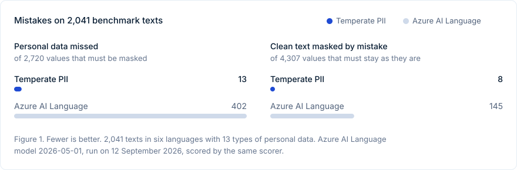
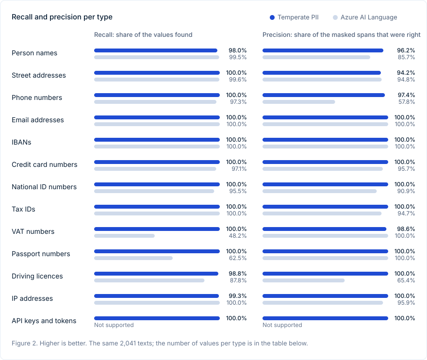

# Temperate PII

Temperate PII finds personal data in European text: names, street addresses, phone numbers, email addresses, IBANs, card numbers, national ID numbers, tax IDs, VAT numbers, passport numbers, driving licences, IP addresses, and API keys and tokens.

Rules per country find the structured values, and check the checksum where a format has one. A small model, distilled from a larger one, finds names and addresses. The service is one Rust binary. It runs on a CPU and answers in about 25 ms for a text of 2,000 characters.

The model is on Hugging Face as [temperate-works/pii](https://huggingface.co/temperate-works/pii).

## Results



The benchmark has 2,041 texts in English, Dutch, German, French, Spanish and Italian. They hold 2,720 values that must be masked and 4,307 values that must stay as they are, such as company names, product codes and order numbers. Temperate PII missed 13 values and masked 8 that it should have left alone. Over the same texts, Azure AI Language missed 402 and masked 145.



| Type | Values | Temperate PII recall | Temperate PII precision | Azure recall | Azure precision |
| --- | ---: | ---: | ---: | ---: | ---: |
| Person names | 205 | 98.0% | 96.2% | 99.5% | 85.7% |
| Street addresses | 275 | 100.0% | 94.2% | 99.6% | 94.8% |
| Phone numbers | 149 | 100.0% | 97.4% | 97.3% | 57.8% |
| Email addresses | 155 | 100.0% | 100.0% | 100.0% | 100.0% |
| IBANs | 144 | 100.0% | 100.0% | 100.0% | 100.0% |
| Credit card numbers | 139 | 100.0% | 100.0% | 97.1% | 95.7% |
| National ID numbers | 334 | 100.0% | 100.0% | 95.5% | 90.9% |
| Tax IDs | 197 | 100.0% | 100.0% | 100.0% | 94.7% |
| VAT numbers | 139 | 100.0% | 98.6% | 48.2% | 100.0% |
| Passport numbers | 136 | 100.0% | 100.0% | 62.5% | 100.0% |
| Driving licences | 344 | 98.8% | 100.0% | 87.8% | 65.4% |
| IP addresses | 140 | 99.3% | 100.0% | 100.0% | 95.9% |
| API keys and tokens | 211 | 100.0% | 100.0% | not supported | not supported |

Recall is the share of the values that were found. Precision is the share of the masked spans that were right.

### Read these numbers with care

We built this benchmark ourselves. 963 of the 2,041 texts are passages of openly licensed prose, most of them from Wikipedia, in which we replaced the real names and put in made-up identifiers. We generated 975 more and wrote 103 by hand. None of the texts come from the training data, but we wrote the cases, and that helps us. In our own measurements, scores on text like this run up to about 15 points higher than scores on real documents.

Azure finds more person names than we do: 99.5% against our 98.0%. It is the one type where we are behind on recall. On street addresses its precision is a little higher too, 94.8% against our 94.2%.

The Azure figures come from Azure AI Language's PII service, model version `2026-05-01`, run on 12 September 2026. The same scorer scored both services. We mapped 39 of Azure's categories onto our 13 types. Azure also finds things we do not score, such as organizations and dates, and those spans did not count against it.

### Hand-written business texts

To get closer to real work, we also wrote 26 business texts by hand: emails, invoices, contracts and meeting notes. Eight are in Dutch, eight in English, seven in German, and one each in French, Spanish and Italian. They hold 83 names and addresses.

Temperate PII finds 76 of the 83. It misses five names, such as "Katrin Weber" in a German email and "Mark" on its own in an English one, and two postcodes with their town, such as "79098 Freiburg im Breisgau". Of the 112 company, product and place names in these texts, it masks one by mistake. We did not run Azure on this set.

### Speed

For texts of 2,000 characters, one request at a time on an Apple M1 Max with four threads, the median answer took 23 ms and the 95th percentile 31 ms. Other work ran on the machine during the measurement.

## Quick start

You need Rust, `curl` and `jq`. `fetch-model.sh` downloads the model from Hugging Face and checks each file against its digest.

```bash
git clone https://github.com/temperate-works/pii
cd pii
./fetch-model.sh
cargo build --release -p pii-detection-api
PII_DETECTION_ARTIFACT_DIR=models/pii-detection-model-full-merged-int8 \
  ./target/release/pii-detection-api
```

The service listens on `127.0.0.1:8090`.

Or run it in a container:

```bash
./fetch-model.sh
docker build -t temperate-pii .
docker run -p 8090:8090 temperate-pii
```

```bash
curl -s http://127.0.0.1:8090/analyze \
  -H 'content-type: application/json' \
  -d '{
    "texts": ["Hoi Sanne, het nieuwe adres is Keizersgracht 123, 1015 CJ Amsterdam. Stuur de factuur naar NL91ABNA0417164300 en bel me op 06 12345678."],
    "entities": ["PERSON", "STREET_ADDRESS", "IBAN_CODE", "PHONE_NUMBER"],
    "language": "nl"
  }'
```

```json
{
  "language": { "requested": "nl", "model_coverage": "trained", "unverified_entity_types": [] },
  "results": [
    [
      { "entity_type": "PERSON", "start": 4, "end": 9, "score": 0.99997 },
      { "entity_type": "STREET_ADDRESS", "start": 31, "end": 67, "score": 0.99996 },
      { "entity_type": "IBAN_CODE", "start": 91, "end": 109, "score": 0.95 },
      { "entity_type": "PHONE_NUMBER", "start": 123, "end": 134, "score": 1.0 }
    ]
  ]
}
```

Each result gives the type, where the value starts and ends in the text, and a score. You get one list of results per text you send.

## API

| Endpoint | What it does |
| --- | --- |
| `POST /analyze` | Finds personal data in one or more texts. Send `texts`, the `entities` to look for, and the `language` of the texts. |
| `GET /capabilities` | Lists the types the service finds, the languages it accepts and the versions of its rules and model. |
| `GET /health` | Answers 200 when the model is loaded and the service is ready. |

Settings, as environment variables:

| Variable | What it sets |
| --- | --- |
| `PII_DETECTION_ADDRESS` | The address the service listens on. The default is `127.0.0.1:8090`; the container uses `0.0.0.0:8090`. |
| `PII_DETECTION_ARTIFACT_DIR` | The folder of the model. |
| `PII_DETECTION_RULES_ONLY` | Runs without the model. The service then finds no names or addresses. |
| `PII_DETECTION_INTRA_THREADS` | The number of threads the model uses for one text. |
| `PII_DETECTION_INFERENCE_SLOTS` | How many texts the model works on at the same time. |

## Redact documents

`scripts/redact.py` sends PDFs or text files to the service and writes a copy in which every value is replaced by a placeholder such as `[PERSON_1]`. The same value gets the same placeholder in every file, so documents can still be compared after redaction. You need [uv](https://docs.astral.sh/uv/) and a running service. To keep the documents on your own machine, start the container with `-p 127.0.0.1:8090:8090`.

```bash
uv run -q scripts/redact.py payslip-1.pdf payslip-2.pdf --out redacted
```

It writes `<name>.redacted.txt` for each file and `mapping.private.json`, which links each placeholder to its original value. Keep the mapping on your own machine. The command prints only the placeholders and their scores; `--show-values` prints the originals too. The language defaults to Dutch; set `--language` for other texts.

On top of the service, the script masks dates of birth and employee numbers by their label, Dutch postcodes with their town, and initials before a name. A PDF without a text layer, such as a scan, needs OCR first. Read the redacted text before you send it anywhere.

## What it finds

| Type | How |
| --- | --- |
| `PERSON` | The model |
| `STREET_ADDRESS` | The model |
| `IBAN_CODE` | Rules, with the checksum |
| `CREDIT_CARD` | Rules, with the checksum |
| `NATIONAL_ID` | Rules per country, with the checksum |
| `TAX_ID` | Rules per country, with the checksum |
| `VAT_NUMBER` | Rules per country |
| `PASSPORT_NUMBER` | Rules per country |
| `DRIVING_LICENCE` | Rules per country |
| `PHONE_NUMBER` | Rules per country |
| `EMAIL_ADDRESS` | Rules |
| `IP_ADDRESS` | Rules |
| `CREDENTIAL` | Rules for API keys, tokens and private keys |

The country rules cover Belgium, France, Germany, Italy, the Netherlands, Spain and the United Kingdom.

The model was trained on English, Dutch, German, French, Spanish and Italian. The service accepts all 24 official languages of the EU. For a language the model was not trained on, the answer says so in `model_coverage` and lists the types it could not check in `unverified_entity_types`.

## How it works

1. The rules find the structured values and check their checksums.
2. The model tags names and addresses. It is a 6-layer student, distilled from a larger teacher and built on Multilingual MiniLM, and it runs as an int8 ONNX model.
3. A precision step drops weak spans from the model, so that it masks fewer words that only look like a name or an address.
4. The results are merged into spans that do not overlap, each with a score.

A surname on its own is left alone on purpose, when no title, greeting, label or earlier full name points to a person. "Vraag het aan Bakker van financiën" stays as it is. Masking every word that could be a surname would also mask many company and place names.

## Run the benchmark yourself

Start the service, then run:

```bash
cargo run --release -p pii-detection-eval --bin eval -- \
  --service http://127.0.0.1:8090 \
  --baseline benchmark/baseline/azure-2026-09-12.json
```

It scores every case in `benchmark/cases/` and writes a report to `benchmark/reports/gate-report.json`. The `latency` tool in the same crate measures the speed.

## Training

`training/` holds the Python code that builds the data, trains the teacher, distils the student and exports it to ONNX. It has its own `pyproject.toml`.

## Licence

The code and the model are licensed under [Apache-2.0](LICENSE).

The model is built on `microsoft/Multilingual-MiniLM-L12-H384` (MIT) and the tokenizer of `FacebookAI/xlm-roberta-base` (MIT). It was trained on `ai4privacy/pii-masking-openpii-1.5m` by ai4privacy (CC BY 4.0) and `Wismut/nym-pii-multilingual-data` (MIT). The benchmark texts in `benchmark/carriers/` are adapted from Wikimedia projects and stay under CC BY-SA 4.0. [NOTICE.md](NOTICE.md) has the details, also for the name lists.

Temperate PII is made by [Temperate](https://temperate.works).
